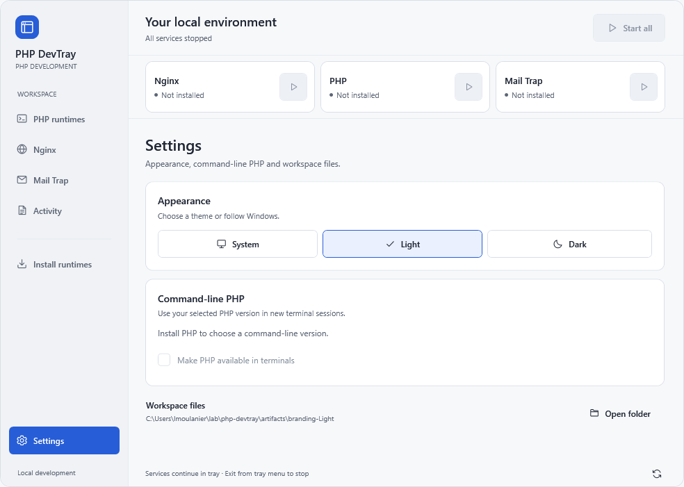

# PHP DevTray

PHP DevTray (PDT) manages local PHP development environments on Windows.

A Windows desktop application that keeps running in the tray using the original **C# / .NET 10 / WPF** stack. The UI and runtime management layer are separate projects; native Windows Job Objects contain the services.

This is **0.8.0 preview**: a Fluent desktop window that hides to the tray on minimize or Close, preserving services and restoring its previous window state. It includes unified PHP/FrankenPHP management, consistent site and runtime cards, service restart actions, runtime installer tabs, compact notifications, and a searchable, session-only Activity stream. The complete version 1.0 specification is still in progress.



## Caddy and FrankenPHP

Caddy, FrankenPHP runtimes and site assignments are stored under `web` in the profile’s `settings.json`.

Open **Install runtimes**, select **Caddy**, then find and install an official Windows x64 release. Install one or more **FrankenPHP** versions or a **PHP NTS** channel from the same page. You can also import an extracted distribution. Downloads are checked against the publisher's SHA-256 digest.

In **PHP runtimes**, use the **PHP NTS** and **FrankenPHP** tabs to install, start, stop or restart an engine. The **Manage extensions…** action on a FrankenPHP runtime opens the searchable module inventory. Bundled DLLs can be enabled or disabled after validation, while built-in modules are read-only. Changes restart a running instance and preserve a stopped instance’s state. The FrankenPHP install list offers the latest stable FrankenPHP release for each available PHP minor branch and shows its exact bundled PHP version. If a PHP build needs a newer Visual C++ runtime, the installation screen can download the signed Microsoft x64 redistributable, run its setup with your approval and retry the selected PHP release.

In **Sites → Add site**, choose the hostname, document root and runtime. The document root is fixed at creation and written directly into the site’s Caddyfile. The site menu lets you enable or disable the site or edit its Caddyfile in `user/caddy/sites/`. Comments explain the root and where to add custom directives. The application adds `php_server` or `php_fastcgi`/`file_server` to the generated configuration according to the selected runtime. Change the runtime from the site row. The displayed document root is read from the Caddyfile using the selected server’s `adapt` command. The app updates this display automatically after Caddyfile saves. **Refresh** also rereads the files. The path and folder action are available when adaptation finds one fixed absolute root.

Select the runtime directly on a site row to switch engines. For a running site, the manager validates the configuration, restarts affected services and attempts to restore the previous route if activation fails. Use **Start all** to bring a stopped environment online. The tray starts the backends needed by enabled sites, then Caddy. Use loopback hostnames such as `app.localhost`. Caddy listens on ports 80 and 443, redirects HTTP to HTTPS, and proxies FrankenPHP sites to their selected instance. FrankenPHP imports its site file. For PHP NTS, Caddy imports the site file and sends PHP requests to the selected FastCGI endpoint. FrankenPHP listens on loopback HTTP with automatic HTTPS disabled.

The front-end Caddy issues and renews local certificates and attempts to install its local root CA into the system trust store. Windows may prompt for permission. Only the HTTP-only FrankenPHP backends use `skip_install_trust`.

## Install

Microsoft Store is the intended distribution channel. The app is not published yet. GitHub Actions builds a self-contained Windows x64 MSIX; tagged builds use the registered Partner Center identity and produce an upload artifact. Microsoft signs and distributes accepted packages. See [Store setup and submission](docs/RELEASING.md).

Store builds provide Start menu access and a Windows-managed `php.exe` command alias. Package-owned runtimes, settings and captured mail survive app updates, but are removed on uninstall/reset. Back up workspace files first. Developer builds can still run directly from the published folder below.

## Run

Open `artifacts/releases/0.8.0/PhpDevTray.exe`. The normal resizable window opens on launch. Minimize or Close hides it to the tray while services continue. Left-click its notification icon to restore it, including its maximized state. Right-click for **Open manager**, **Start all / Stop all**, and **Exit and stop services**.

Enable **Settings > Startup > Start PHP DevTray with Windows** to start the configured services when you sign in, with no manager window. The tray icon remains available. This option is off by default. Startup failures are recorded in the application logs and can be inspected by opening the manager. A manual launch still opens the window.

The published folder is self-contained for Windows x64. Keep the full folder, including `cli/`, together. No .NET installation is required to run this published build. PHP retains its own Visual C++ prerequisite.

To launch the application from a terminal, run:

```powershell
.\artifacts\releases\0.8.0\PhpDevTray.exe
```

Unpackaged application data is stored in `%LOCALAPPDATA%\PhpDevTray`. Store builds use `%LOCALAPPDATA%\Packages\<PackageFamilyName>\LocalState\PhpDevTray`. No runtimes are bundled or started on first launch. Unpackaged PATH integration is off until explicitly enabled; Store builds use Windows' App execution aliases controls instead.

For an isolated development profile:

```powershell
.\artifacts\releases\0.8.0\PhpDevTray.exe --data-directory C:\Dev\PhpDevTrayData
```

Exit the older tray instance before opening the new executable. Only one ordinary instance runs in a Windows session. Exit the existing instance before changing its data-directory argument.

## Standalone PHP and Mailpit

Install standalone PHP and Mailpit from **Install runtimes**. Mailpit uses ports 39327 (SMTP) and 8025 (HTTP). Select a PHP channel in Settings for the independent CLI.


To update a PHP channel, open its runtime actions and choose **Check for updates**. Review the active/selected patch and choose **Update PHP**. The previous patch is kept under **Previous patches** for an explicit switch back. Each channel keeps its port, extension choices, sites, and CLI default. Running PHP restarts after validation. See [PHP update behavior and recovery](docs/PHP-UPDATES.md).


## Included

- Single-instance native notification icon and three-command native context menu.
- Redesigned WPF popup with runtime cards, site controls, a searchable mail inbox, clearer installation states, and focused extension/site dialogs. Navigation adapts to narrow work areas.
- Persisted System, Light, and Dark appearance choices, native high-contrast colors, accessible control names, and explicit progress/error states.
- Import and validation of extracted PHP and Mailpit distributions.
- Official release discovery, publisher-verified downloads, safe extraction, progress, and cancellation for new installations and PHP patch updates.
- PHP patch activation with validation before transition, readiness checks, retained patches, and recovery of the previous running state on failure or cancellation.
- Simultaneous PHP minor channels, per-channel configuration, immutable resolved INI snapshots, CLI default, and explicit user PATH toggle.
- Caddy, FrankenPHP, PHP and Mailpit process supervision with endpoint ownership verification and periodic health checks.
- Actual PHP extension inventory and bundled DLL toggles, including Zend OPcache handling and conflict detection.
- Suspended process creation, Job Object assignment before resume, kill-on-close containment, and isolated service groups.
- Persistent Mailpit storage, actual inbox listing, and plain-text message reading.
- Activity and Mail Trap refresh automatically every second while their page is visible. Mail polling requires a running Mail Trap; page refresh stops when hidden or another section is selected.
- Atomic settings with backups, preserved user configuration, and application/process logs.
- Source, repeatable build/publish scripts, console verification harness, and isolated UI screenshot mode.

## Current boundaries

- **PHP patch updates are supported.** Mailpit updates, runtime uninstall, and application self-update are not implemented. The download UI still blocks installed Mailpit replacements.
- One active PHP patch per minor channel, with previous patches retained for explicit switching. Same-patch Windows rebuild replacements are rejected; rebuild identity tracking and retained-binary cleanup are pending.
- PHP activation recovers from handled errors/cancellation, including failed readiness or settings publication. Durable crash-recovery journaling across sudden process/OS termination is not implemented.
- Third-party extension installation and advanced per-site extension profiles are not implemented. Bundled extensions are supported.
- Mail supports actual plain-text message inspection and local subject/sender filtering of the loaded inbox. HTML preview, attachment handling, server-side search, deletion, and retention UI are pending. No browser renderer is loaded.
- Store submission and installed-package acceptance testing remain pending. Data-directory migration, settings editor for ports, and automatic restart policy are not implemented.
- The ordinary offline checks use real Windows process/protocol fixtures and simulated binaries for configuration cases. The separate upstream test downloads verified actual distributions into an isolated profile and never changes user PATH or hosts.
- Native-menu interaction, full keyboard/screen-reader flows, Explorer restart, and mixed-DPI/multi-monitor behavior require interactive acceptance testing. Memory and the 200 ms popup target have not been benchmarked.
- Logging currently uses a bounded native process-output stream and structured JSON application files through BCL code. Microsoft.Extensions logging/DI integration and retention are later foundation refinements.

## Build and verify

Requirements: Windows x64, .NET 10 SDK, and PowerShell. Self-contained publishing restores Microsoft's runtime packs. See [third-party notices](THIRD-PARTY-NOTICES.md).

```powershell
.\scripts\build.ps1
.\scripts\build.ps1 -Publish
```

An explicit SDK executable is also supported:

```powershell
.\scripts\build.ps1 -DotNetPath C:\Tools\dotnet\dotnet.exe -Publish
```

The first command builds Release and runs the process/configuration checks plus WPF control-resource regression checks. Publishing creates the complete Windows app under `artifacts/releases/0.8.0/` and deploys the independent PHP launcher under `artifacts/releases/0.8.0/cli/`.

With the Windows SDK installed, `scripts/build-store-package.ps1 -DevelopmentIdentity` packages that output into a test MSIX under `artifacts/store/`. Store submission requires the exact Partner Center identity; see [release instructions](docs/RELEASING.md).

For a rendered popup smoke test without touching the ordinary application profile:

```powershell
.\artifacts\releases\0.8.0\PhpDevTray.exe --smoke-test C:\Dev\PdtSmoke --screenshot C:\Dev\PdtSmoke\popup.png
```

This creates an isolated empty profile, renders the actual WPF popup, writes a PNG, cleans up the tray resources, and exits. Add `--smoke-section Settings` to inspect another section, `--theme Dark` for the dark palette, or `--verify-ui` for contrast and accessible-name assertions. `--smoke-width 860` forces a test viewport even on a smaller display; omit it to exercise work-area sizing.

See [the UI review](docs/UI-REVIEW.md), [architecture and implementation decisions](docs/ARCHITECTURE.md), and [verification record](docs/VERIFICATION.md). The supplied original specification is preserved as [SPEC-v1.1.md](docs/SPEC-v1.1.md).

The opt-in web setup check downloads verified Caddy and FrankenPHP distributions, imports a local Windows x64 NTS distribution into a temporary profile and serves one site through each engine. Pass the path to that distribution's `php.exe` after `--real-web-setup`. The request test uses an isolated HTTP port and validates the production HTTPS configuration with both native binaries.

The separate PHP patch acceptance test downloads an archived official Windows PHP build, verifies its publisher SBOM checksum, and exercises live update/rollback against the current release:

```powershell
dotnet tests/PhpDevTray.Checks/bin/Release/net10.0-windows/PhpDevTray.Checks.dll --real-php-updates --profile C:\Dev\PdtPatchChecks --cli-bundle C:\Dev\PhpDevTray\artifacts\releases\0.8.0\cli --report C:\Dev\PdtPatchReport.md
```

Use a new empty profile and available PHP backend ports. This test starts actual PHP processes inside Jobs, leaves unrelated listeners alone, and does not enable PATH integration or modify hosts. Results are recorded in [REAL-PHP-UPDATES.md](docs/REAL-PHP-UPDATES.md).

For the opt-in actual-runtime checks, build/publish first, then invoke the checks executable with absolute paths:

```powershell
dotnet tests/PhpDevTray.Checks/bin/Release/net10.0-windows/PhpDevTray.Checks.dll --real-runtimes --profile C:\Dev\PdtIntegration --cli-bundle C:\Dev\PhpDevTray\artifacts\releases\0.8.0\cli --report C:\Dev\PdtIntegrationReport.md
```

Use a dedicated empty profile. The harness requires available PHP backend ports, installs two PHP channels plus Mailpit, selects temporary SMTP/HTTP ports, runs the assertions, and stops all owned services. The profile remains available for diagnosis. It never kills unrelated listeners or changes PATH/hosts.
