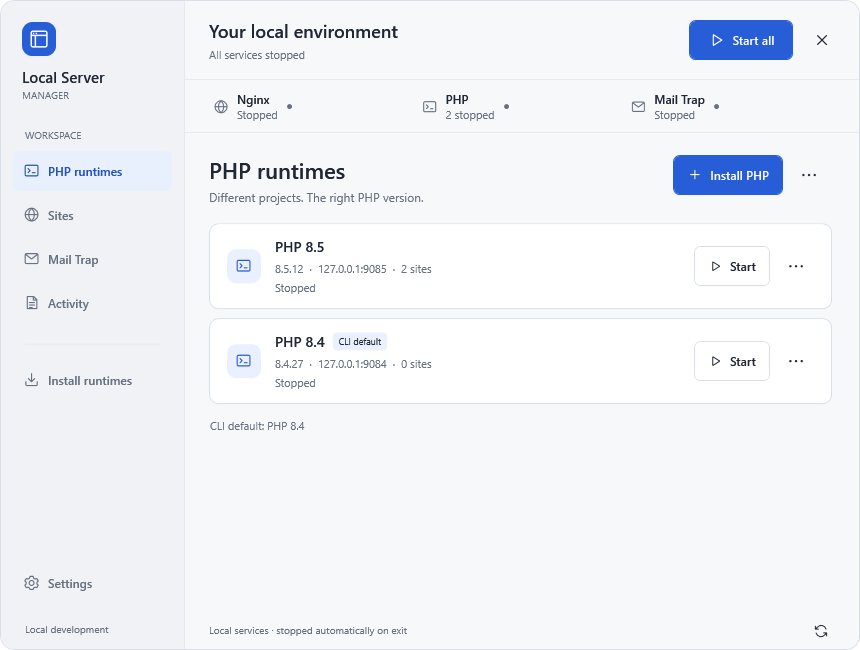
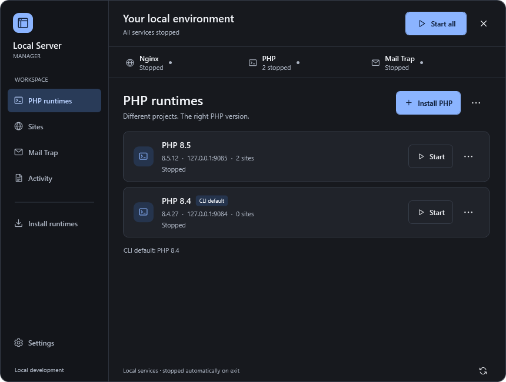
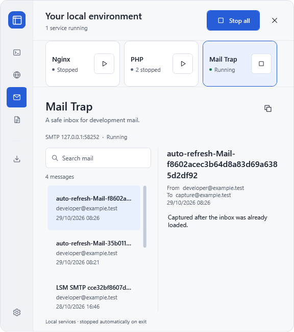
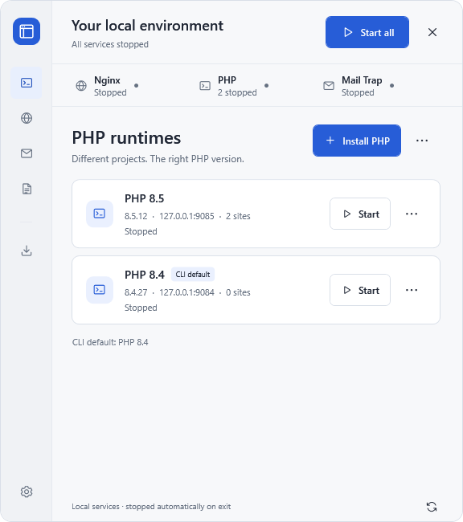
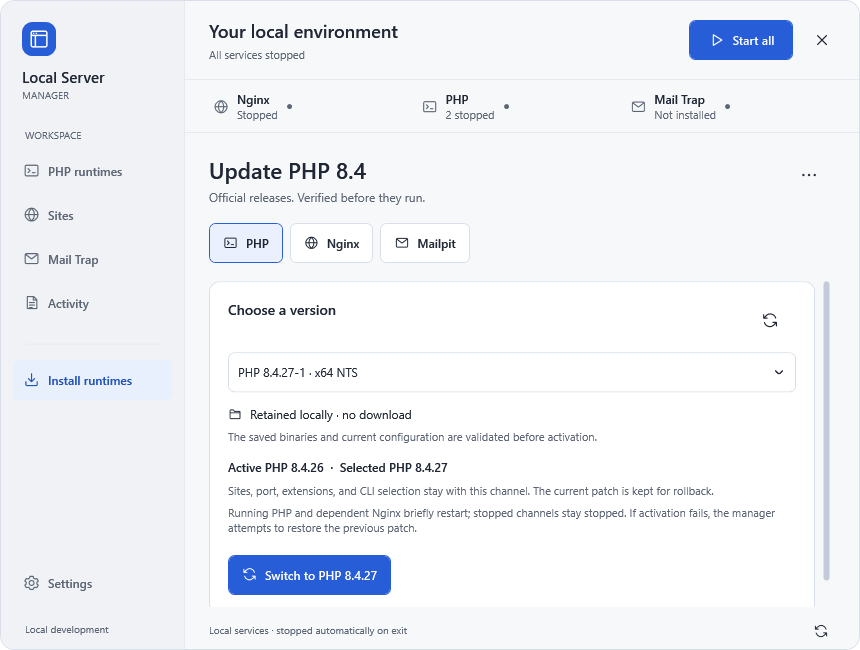
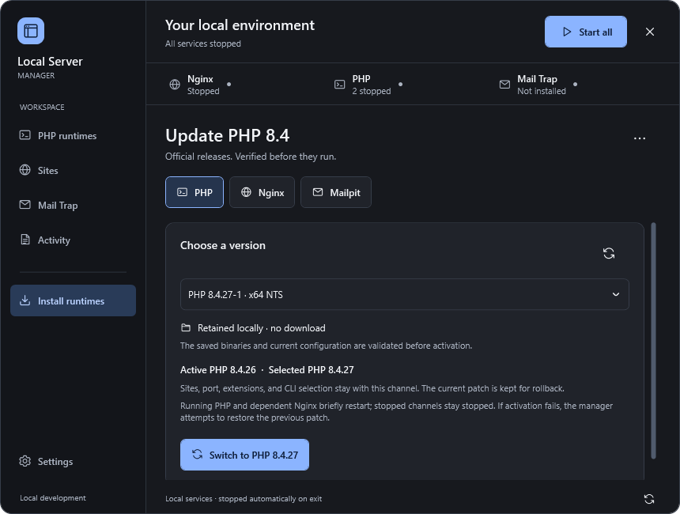
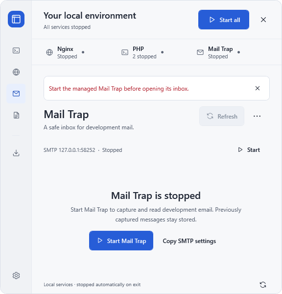
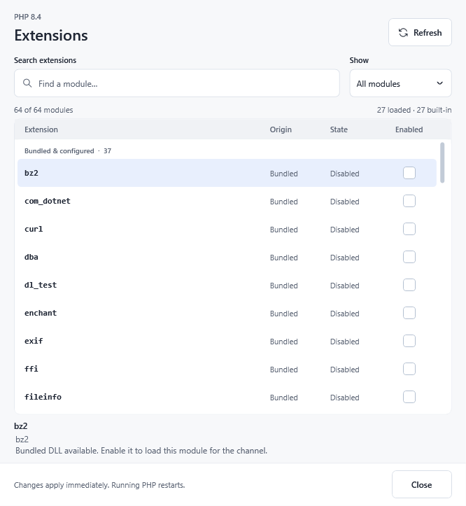
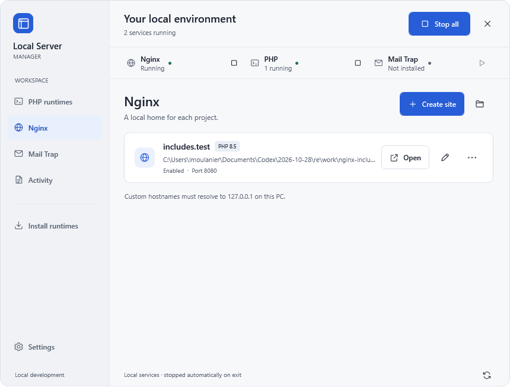
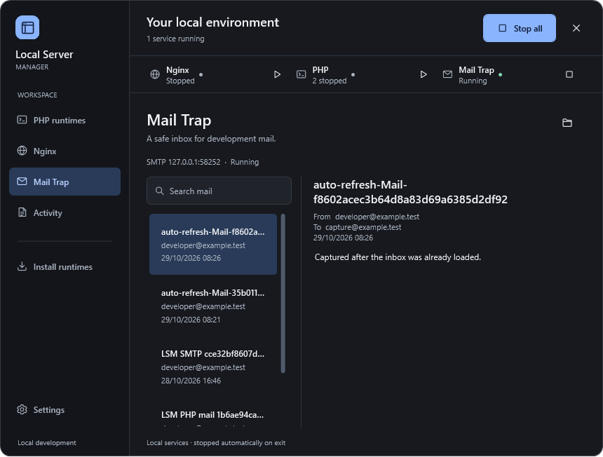

# Preview 0.3 UI review

28 October 2026. Mode: **full**. Scope: the six manager sections, extension inventory, and site creation form. Framework: native WPF on .NET 10, using the application's resource dictionary, dynamic theme brushes, and code-native vector icons. No browser renderer or additional UI framework was introduced.

## Coverage

| Category | Evidence inspected | Result |
| --- | --- | --- |
| Typography | Actual light/dark PNGs, long message subjects, version picker, status strip, extension rows, site form | Clear after wrapping, truncation, spacing, and picker fixes |
| Surfaces | Sidebar, header, cards, empty/error states, native control templates, two dialogs; 860-DIP viewport and constrained work area | Clear in inspected captures; narrow navigation uses an icon rail |
| Animations | Theme preference/motion handlers and template state definitions | Routine transitions remain immediate; live motion playback not reviewed |
| Icons | Every vector geometry parsed; inherited foreground asserted; inspected selected navigation, actions, status, and form icons | Clear for rendering and resource inheritance |
| Performance | Cached frozen palettes and structural refresh signatures; code inspection and resource identity assertions | Repeated theme application reuses resources; idle memory and opening latency were not benchmarked |

## Changes

The findings below are implemented. Locations refer to the final source; related changes are grouped by their shared user impact.

| Severity | Location | Before | After | Why |
| --- | --- | --- | --- | --- |
| MEDIUM | `src/LocalServerManager.App/ManagerWindow.cs:72`, `:270`, `:323`, `:487` | Crowded navigation and many competing actions | Grouped sidebar, global service action, compact service strip, runtime/site cards, primary actions with overflow menus, dedicated installer states | Clear hierarchy and grouping make common tasks easier to find |
| HIGH | `src/LocalServerManager.App/ManagerWindow.cs:149` | Labels clipped when the tray popup was constrained by the work area | Full labels in a 184-DIP sidebar; 64-DIP icon rail with tooltips and accessible names below 730 DIPs | Text wrapping and minimum hit areas must remain usable on smaller work areas |
| MEDIUM | `src/LocalServerManager.App/ManagerWindow.cs:377` | Sparse mail view, unexplained search field, long subjects dominating rows, no initial message selection | Search prompt/icon, compact truncated subject/sender rows with tooltips, selected message detail, first-message loading and valid selection preservation | Typography and selection context make the actual inbox readable |
| MEDIUM | `src/LocalServerManager.App/ManagerWindow.cs:479` | Raw JSON records in a small horizontally scrolling text area | Local timestamps, severity and message text on separate lines, readable wrapping and selectable text; original files remain available through Open log folder | Typography and wrapping let users read events without decoding serialization fields |
| HIGH | `src/LocalServerManager.App/App.xaml:174` | Custom ComboBox rendered a RuntimeRelease record's internal fields | Selected and dropdown presenters retain native template selectors/string formatting; friendly DisplayMemberPath labels are regression-tested | A version selector must expose readable choices |
| MEDIUM | `src/LocalServerManager.App/App.xaml:45`, `src/LocalServerManager.App/ThemeManager.cs:9`, `src/LocalServerManager.Infrastructure/EnvironmentManager.cs:264` | Incomplete control styling and system-only appearance choice | Shared button/input/list/menu/scrollbar templates, visible focus, stable disabled geometry, 40-DIP targets, contrast-checked palettes, persisted System/Light/Dark choices and system high-contrast resources | Consistent surfaces and native control semantics support readability and interaction |
| MEDIUM | `src/LocalServerManager.App/ExtensionsDialog.cs:13`, `:276` | Extension controls lacked a compact inspection hierarchy | Search, status filter, grouped module table, enable checkboxes, counts and selected-module details | Grouping and progressive disclosure separate inspection from changes |
| MEDIUM | `src/LocalServerManager.App/SiteDialog.cs:15` | Flat site form with less context | Labeled fields, inline folder chooser, paired PHP/port inputs, address preview, field validation and focus | Clear labels and focused errors explain what a site needs |
| LOW | `src/LocalServerManager.App/Controls/UiIcon.cs:14` | Inconsistent action imagery | One vector icon set with inherited action colors and contextual sizing | Shared geometry and state colors keep icon weight and alignment consistent |
| MEDIUM | `src/LocalServerManager.App/ManagerWindow.cs:186` | Refreshes could reconstruct active input controls | Update statuses in place; rebuild structural content when its data changes, retaining release choice, mail search/selection and log selection | Motion restraint and stable controls protect ongoing interaction |

## Verification

- Release solution build: **0 warnings, 0 errors**. Full process/configuration suite and the new `LocalServerManager.UiChecks` suite passed.
- UI resource checks use actual WPF templates. They assert native text selection, ComboBox selection/editable/popup parts, checkbox UI Automation toggle, list selection, scrollbar/menu parts, stable disabled geometry, cached brushes, vector parsing, contrast and high-contrast resource mapping. These checks open no windows and do not change OS preferences.
- Actual WPF captures cover PHP, sites, Mail Trap, Activity, Install runtimes, Settings, extensions, site creation, empty and error states. Both palettes were captured for PHP, Settings and the dialogs. Preview 0.3's self-contained executable also passed light/dark PHP, constrained-work-area and Activity smoke captures.
- Each `images/redesign-*.png.qa.txt` records rendered dimensions, checked contrast pairs, enabled-control names, and navigation-label fit. Checked normal-text pairs exceed 4.5:1 in both palettes. This is a targeted check, not a full accessibility audit.
- PHP/extension and mail screens use the isolated real-runtime profile; mail detail comes from the actual Mailpit API. The installer capture uses official live release metadata. Only the fixture's Mailpit service was started for the inbox capture; a foreign PHP listener was left untouched. Smoke shutdown left no running processes under the fixture profile.
- Desktop automation approval timed out before the live keyboard check. Keyboard traversal, screen-reader announcements, native menus, Explorer restart, mixed-DPI/multiple-monitor positioning, and native title-bar appearance remain unverified interactively. No claim of completed interactive acceptance is made.
- The full upstream runtime integration was already passed for preview 0.2 and is documented in [REAL-INTEGRATION.md](REAL-INTEGRATION.md). It was not repeated for this UI-focused release.

## Captures

The 860-DIP captures use an explicit smoke viewport; the compact capture uses the actual tray work-area constraint. Dialog captures show client content only. Further captures and adjacent assertion records are in `docs/images/`.

## Preview 0.4 extension

Mode: **full**, scoped to the PHP update/retained-switch flow and its shared theme resources. The existing WPF styling system is retained.

| Category | Evidence inspected | Result |
| --- | --- | --- |
| Typography | Actual active/selected version labels, preservation/restart copy, retained count, light/dark and 576-DIP captures | Clear after singular site-label and inherited text-color fixes |
| Surfaces | Existing card/scroll layout, scoped release picker, runtime action additions; actual rendered text over solid drawing surfaces | Existing hierarchy retained; secondary text darkened to pass sidebar and interaction-surface contrast |
| Animations | New actions use existing immediate state changes | No new routine animation |
| Icons | Existing folder/download/restart geometries and inherited foreground | Clear in inspected captures |
| Performance | Existing render signatures and throttled progress updates | No new idle polling; memory/opening latency remain unbenchmarked |

| Severity | Location | Before | After | Why |
| --- | --- | --- | --- | --- |
| MEDIUM | `src/LocalServerManager.App/ManagerWindow.cs:319`, `:523`, `:668`, `:762` | Existing channels were blocked by new-install-only UI | Channel-specific checks, active/selected comparison, Update/Switch/Already installed actions, retained count and explicit patch switch menu; local activation avoids another download | Clear action hierarchy and copy explain which patch will be activated and what restarts |
| HIGH | `src/LocalServerManager.App/ManagerWindow.cs`, runtime verification line | A non-button icon/text panel inherited black text inside the release ContentControl in dark mode | Explicit dynamic TextBrush on the panel; render assertions check the actual visible text against nearby painted solid surfaces | Resource inheritance must preserve readable text on every surface |
| MEDIUM | `src/LocalServerManager.App/ThemeManager.cs:101`, `src/LocalServerManager.App/App.xaml`, secondary-text palette | Muted light-theme text passed card contrast but reached only 4.41:1 on the sidebar | Light muted color is `#5D6676`; palette checks cover sidebar, hover and pressed surfaces, and render checks cover enabled visible text | Contrast depends on the actual background, not only the primary card |
| LOW | `src/LocalServerManager.App/ManagerWindow.cs`, PHP runtime metadata | A single assigned site displayed “1 sites” | Singular “1 site” | Small copy details keep counts readable |

The complete offline/native process suites and actual-runtime update/rollback acceptance test pass. After the final theme changes, native WPF resource tests and source captures for Settings, extensions, site creation, mail, sites, empty/error states pass. Published light/dark and narrow update captures are saved below. Assertions are targeted: transparent/complex background composition, actual keyboard/menu interaction, and screen-reader output still need interactive acceptance.

## Preview 0.4.1 notification correction

Mode: **quick**, scoped to the supplied notification/empty-inbox clipping screenshot and shared WPF empty states.

| Category | Evidence inspected | Result |
| --- | --- | --- |
| Typography | One-line and long wrapped notification text, stopped Mail Trap copy | Bounded message scrolling; stopped service has an appropriate action |
| Surfaces | Published 576 × 600 light/dark captures with/without notification; source PHP/install empty states and running inbox | Actions fit the reproduced cases; scroll-to-end assertions confirm reachability |
| Animations | No new animation; existing layout events only | Unchanged |
| Icons | Start/refresh actions use existing play/refresh vectors | Contextual action icons |
| Performance | Empty-state SizeChanged layout adjustment and existing service snapshots | No new polling or idle timer; not benchmarked |

| Severity | Location | Before | After | Why |
| --- | --- | --- | --- | --- |
| HIGH | `src/LocalServerManager.App/ManagerWindow.cs`, notification shell and `Empty` | Notification reduced a fixed empty-state area's space and clipped lower actions | Compact banner, bounded scrollable details with a separate dismiss target; adaptive empty-state spacing/actions and scroll fallback; body stays inside its bounds | Minimum hit areas and readable grouping require actions to remain reachable |
| MEDIUM | `src/LocalServerManager.App/ManagerWindow.cs`, Mail Trap entry/refresh/start paths | Stopped service offered an empty inbox/refresh flow that triggered an expected service-unavailable error | Explicit stopped state with Start action/play icon; refresh requires a running service; start/restart reads mail after readiness; running empty-inbox refresh uses a refresh icon | Action copy and icons should lead to a valid next step |

The notification below is injected for reproduction. Opening a stopped Mail Trap normally shows the stopped state without generating that error.

## Preview 0.4.2 input spacing and table density

Mode: **quick**, scoped to the supplied search-input screenshot, the shared TextBox template and extension selection table.

| Category | Evidence inspected | Result |
| --- | --- | --- |
| Typography | Native first-character rectangle, search/placeholder alignment, actual site forms in both themes | Duplicate left padding removed; native text selection preserved |
| Surfaces | Actual extension inventory in both themes at unchanged window size | Reduced chrome and row spacing; 40-DIP checkbox targets retained |
| Animations | No animation changes | Unchanged |
| Icons | Existing search icon inset and text start after the fix | Clear separation without excess gap |
| Performance | Template change and existing inventory rendering | No new timers or work on idle; not benchmarked |

| Severity | Location | Before | After | Why |
| --- | --- | --- | --- | --- |
| MEDIUM | `src/LocalServerManager.App/App.xaml`, TextBox PART_ContentHost | Padding was applied by both the template margin and native text view; 34-DIP padding produced a70-DIP text start | Native text view applies the inset once; geometric regression assertion passes | Optical alignment keeps entered text close to the search icon and aligned with the intended inset |
| MEDIUM | `src/LocalServerManager.App/ExtensionsDialog.cs` | 44-DIP rows, larger headers/margins/details and redundant subtitle reduced visible inventory | 40-DIP rows/targets, 28-DIP table header, compact groups/chrome/details and a narrower Enabled column | Grouping and minimum hit areas allow a denser table without shrinking the toggle target |

## Preview 0.4.3 live sections

Mode: **quick**, scoped to Activity/Mail Trap refresh and reading-state stability.

| Category | Evidence inspected | Result |
| --- | --- | --- |
| Typography | Empty-inbox copy and actual newly appended log text | New mail is described as automatic; new records appear without a click |
| Surfaces | Published inbox/activity captures with real external data insertion | Header/footer refresh controls removed; mail selection stays on its existing message |
| Animations | Background refresh avoids the foreground busy path | No periodic loading flash or new animation |
| Icons | Removed refresh actions; existing service/folder controls retained | Clear |
| Performance | Real dispatcher tests for interval, slow read, cancellation, hide and disposal | Single read at a time; no page timer while hidden; memory/latency not benchmarked |

| Severity | Location | Before | After | Why |
| --- | --- | --- | --- | --- |
| MEDIUM | `src/LocalServerManager.App/ManagerWindow.cs`, Activity/Mail Trap | Updated data required manual Refresh actions | One-second automatic refresh on the visible page; no refresh buttons or stopped-mail API requests | A live section should show new data without repeated actions |
| MEDIUM | `src/LocalServerManager.App/ManagerWindow.cs`, data application; `PageAutoRefresher.cs` | Foreground read path disabled controls and replaced loaded collections | Quiet scoped reads, unchanged-data detection, preserved mail search/selection/offsets, and postponed selected-log-text replacement | Stable controls and motion restraint protect reading and copying |

See the0.4.3 verification record for the actual SMTP/file injection checks and coverage limits.

## Preview 0.5 summary controls

Mode: **quick**, scoped to service summary controls, page shortcuts and per-site configuration editing. Existing WPF resources/icons are reused.

| Category | Evidence inspected | Result |
| --- | --- | --- |
| Typography | Actual normal/compact service labels and status text | Compact layout hides decorative service glyphs to preserve room for labels and controls |
| Surfaces | 576-DIP source and860-DIP published Nginx/Mail captures, both palettes | Icon-only bar controls; title actions simplified; site edit action fits |
| Animations | Existing snapshot updates and immediate action states | No new animation |
| Icons | Play/stop, folder, site pencil and disabled missing-runtime controls | Existing vector set, tooltips, accessible names and40-DIP targets |
| Performance | Existing snapshot/service operations | No new polling or timer; not benchmarked |

| Severity | Location | Before | After | Why |
| --- | --- | --- | --- | --- |
| MEDIUM | `src/LocalServerManager.App/ManagerWindow.cs`, service strip/page headers | Start/stop actions were in page title rows and page menus held configuration access | Separate icon-only service-strip toggles; page folder shortcuts; runtime/site row menus retained; runtime import remains a body action | Consistent placement and contextual icons reduce repeated header controls |
| MEDIUM | `src/LocalServerManager.App/ManagerWindow.cs`, site rows | Site config editing required folder navigation | Direct pencil action for each site; missing source files are ensured by the catalog without overwriting existing text | A direct action gives each site a clear editing path |

